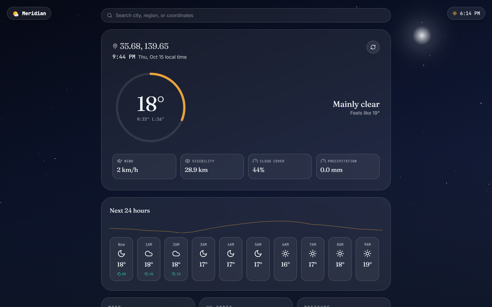
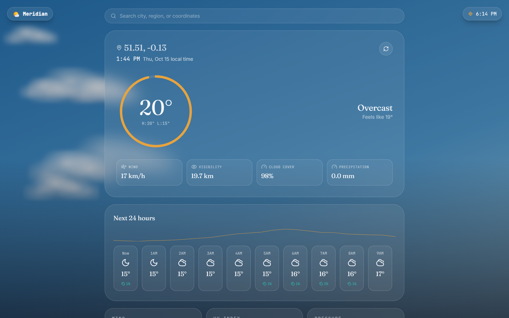
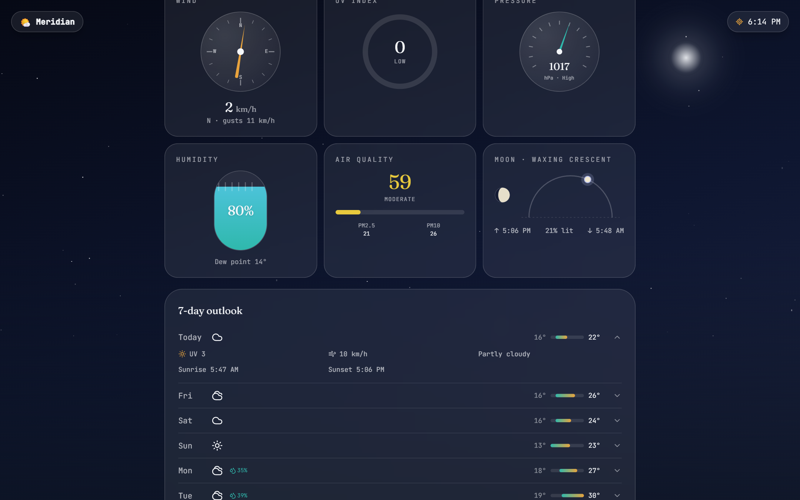
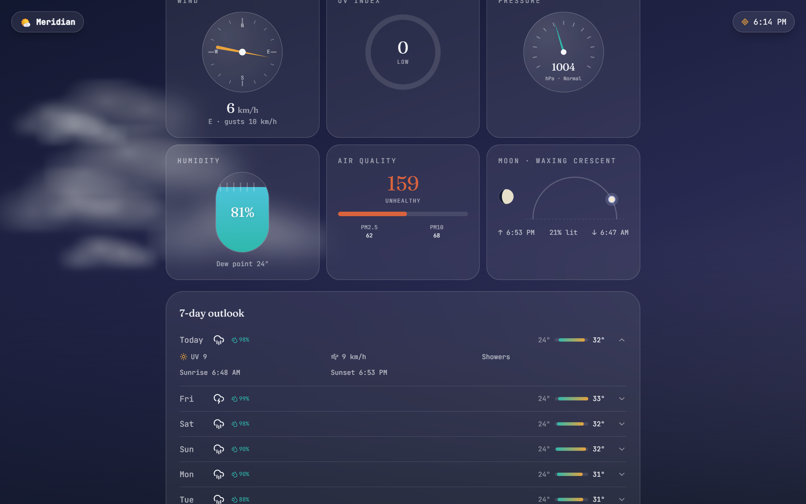
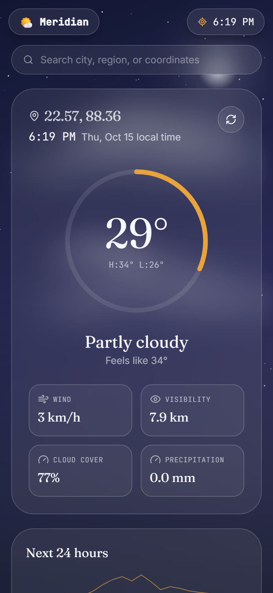

<div align="center">


<a href="https://github.com/RajdipDhar2007/meridian-weather">
  
</a>

<br/>

[](./LICENSE)
[](https://react.dev/)
[](https://www.typescriptlang.org/)
[](https://vitejs.dev/)
[](https://tailwindcss.com/)
[](https://www.framer.com/motion/)


</div>


## 🌌 What is Meridian?

> **Most weather apps show you numbers. Meridian shows you the *sky*.**

Meridian is a production-quality weather web app styled like a pilot's instrument panel. A live, GPS-driven sky repaints itself in real time — golden at dusk, star-strewn on clear nights, black and thundering in a storm — while buttery animated dials report everything from wind to the *exact* phase of the moon.

It runs entirely on free, keyless APIs ([Open-Meteo](https://open-meteo.com/) + [OpenStreetMap](https://www.openstreetmap.org/)) — **no API keys, no backend, no sign-up.** Clone it, run it, done.

## 📸 See It In Action

<div align="center">


<br/><sub>🌙 A clear night in Tokyo — twinkling stars, glowing moon, live 24-hour trend</sub>

<br/><br/>


<br/><sub>☁️ An overcast London sky — soft drifting clouds and a layered blue gradient</sub>

<br/><br/>


<br/><sub>🎛️ The instrument panel — wind compass, UV meter, pressure gauge, humidity fill, AQI &amp; exact moon phase</sub>

<br/><br/>


<br/><sub>🌧️ A showery tropical day — 7-day outlook with rain probability</sub>

<br/><br/>


<br/><sub>📱 Fully responsive down to phone screens</sub>

</div>


## 📑 Table of Contents

- [📸 See It In Action](#-see-it-in-action)
- [✨ Features](#-features)
- [🎛️ The Instrument Panel](#️-the-instrument-panel)
- [🚀 Getting Started](#-getting-started)
- [🧰 Available Scripts](#-available-scripts)
- [🗂️ Folder Structure](#️-folder-structure)
- [🧠 Design & Architecture Notes](#-design--architecture-notes)
- [🛠️ Tech Stack](#️-tech-stack)
- [🤝 Contributing](#-contributing)
- [⭐ Show Some Love](#-show-some-love)
- [📜 License](#-license)

## ✨ Features

| | |
|---|---|
| 📍 **Auto GPS** | Locates you on load, with graceful manual search/map fallback if permission is denied |
| 🌡️ **Rich conditions** | Temperature, feels-like, humidity, dew point, pressure, wind speed/gusts/direction, cloud cover, visibility, UV, precipitation, air quality (AQI, PM2.5, PM10) |
| 🎛️ **Animated dials** | Temperature gauge, wind compass, UV meter, pressure gauge, humidity fill, AQI indicator, sun arc, moon arc + exact moon phase |
| 📈 **Forecasts** | 24-hour scrollable forecast with trend line, plus an expandable 7-day outlook |
| 🌧️ **Living sky** | Condition + time-of-day aware gradients, fluffy tone-shifting clouds, rain/snow/fog particles, lightning, twinkling stars |
| 🗺️ **Interactive map** | Click, drag the marker, or search to jump anywhere — the view auto-recenters |
| 🔎 **Smart search** | Debounced city/coordinate search with autosuggestions and recent locations |
| 🕐 **Local time** | Live clock for the selected place, plus a persistent home-location clock and "locate me" button |
| ♿ **Accessible** | Responsive glassmorphic UI for mobile, tablet and desktop, with `prefers-reduced-motion` support throughout |

## 🎛️ The Instrument Panel

| Instrument | What it tells you |
| --- | --- |
| 🌡️ Temperature Gauge | Current & feels-like temperature at a glance |
| 🧭 Wind Compass | Direction, speed and gusts on a live needle |
| ☀️ Sun Arc | A glowing marker sweeping today's sunrise → sunset |
| 🌙 Moon Arc | Tonight's span plus the *exact* phase, illumination % and name |
| 🕶️ UV Meter | UV index with risk level |
| 🧪 Pressure Gauge | Barometric pressure trend |
| 💧 Humidity Fill | A liquid fill that rises with humidity |
| 🌫️ AQI Indicator | Air quality with PM2.5 / PM10 |

## 🚀 Getting Started

### Prerequisites

- [Node.js](https://nodejs.org/) 18 or later
- npm (bundled with Node.js)

### Installation

```bash
git clone https://github.com/RajdipDhar2007/meridian-weather.git
cd meridian-weather
npm install
```

### Run locally

```bash
npm run dev
```

Open [http://localhost:5173](http://localhost:5173) in your browser and let the sky greet you. 🌅

### 🔑 Zero config, zero keys

No API keys or environment variables are required — Open-Meteo's forecast, air-quality, and geocoding endpoints, plus OpenStreetMap tiles, are all free and unauthenticated.

## 🧰 Available Scripts

| Command           | Description                                              |
| ----------------- | -------------------------------------------------------- |
| `npm run dev`     | Starts a local dev server with hot reload                |
| `npm run build`   | Type-checks the project and builds for production (`dist/`) |
| `npm run preview` | Serves the production build locally for a final check    |
| `npm run lint`    | Runs ESLint across the project                           |

## 🗂️ Folder Structure

```text
src/
├── components/
│   ├── Background/      # sky, clouds, particles, stars, lightning
│   ├── CurrentWeather/  # hero section
│   ├── Forecast/        # hourly & weekly outlook
│   ├── Instruments/     # gauges, compass, sun/moon arcs, AQI
│   ├── Layout/          # logo, clocks, loading & error screens
│   ├── Map/             # Leaflet location map
│   └── Search/          # debounced search bar
├── hooks/               # useWeather, useClock, useGeolocation, useDebounce
├── services/            # Open-Meteo + geocoding clients
├── types/               # shared TypeScript types
└── utils/               # astronomy, theme resolver, time, formatting
```

## 🧠 Design & Architecture Notes

<details>
<summary><b>🕰️ Everything reads in the selected location's own local time</b></summary>

Open-Meteo returns naive timestamps that are already local to the queried place (no UTC offset attached); `utils/time.ts` treats these consistently as "local-as-UTC" instants instead of letting the browser reinterpret them through the device's timezone — the bug that used to skew sunrise/sunset, the hourly strip, and the day/night theme whenever you looked up a place in a different timezone from your own. `useClock` then renders a live, ticking clock in the hero section using the location's real IANA timezone.
</details>

<details>
<summary><b>🏠 Your own location is always one tap away</b></summary>

A persistent badge in the top-right corner shows your device's own local time at all times, independent of whatever place you're currently viewing, and doubles as a "return to my location" button that re-requests GPS and reloads.
</details>

<details>
<summary><b>🌦️ The sky is a layered, condition-and-time-aware system</b></summary>

`utils/theme.ts` + `components/Background/`, not a single background image swap. A resolver turns `(weather condition, time of day)` into a set of independent layers — sky gradient, cloud density/tone, rain/snow intensity, fog, lightning, stars — so rain-at-night and rain-at-noon, or a daytime overcast sky and a stormy black one, all render distinctly instead of sharing one look:

- Clouds are built from several overlapping soft blobs rather than flat ellipses, and recolor by context: white for fair/overcast skies, slate for snow, charcoal-black for rain and thunderstorms.
- Rain, snow, and fog are canvas-particle systems that dim and cool in tone at night versus brighter by day.
- Thunderstorms combine heavy dark clouds, heavy rain, and irregular full-scene lightning flashes with an occasional bolt silhouette — not just a flash with no precipitation.
- Clear nights and partly-cloudy nights show a twinkling star field; fully overcast, rainy, snowy, or foggy skies correctly hide the stars.
- All particle animation respects `prefers-reduced-motion`.
</details>

<details>
<summary><b>🌙 Sun and Moon share one instrument slot</b></summary>

They swap automatically with `current.isDay`: by day, `SunArc` sweeps a glowing marker across today's sunrise–sunset arc; by night, `MoonArc` sweeps across tonight's span and renders the *exact* current phase — computed from a real synodic-month calculation (not a lookup table) — as a proper limb-and-terminator SVG silhouette, alongside illumination % and phase name.
</details>

<details>
<summary><b>🗺️ The map always shows where you are</b></summary>

Leaflet's `center` prop only applies on first mount, so `LocationMap` includes a small `useMap()` helper that flies the view (and re-drops the pin) to the new coordinates any time the selected location changes — via search, GPS, or a map click/drag — instead of leaving you to hunt for the pin yourself.
</details>

<details>
<summary><b>🛡️ Resilient data layer</b></summary>

`services/openMeteo.ts` caches responses for 5 minutes, retries failed requests with backoff, and refreshes silently every 10 minutes; `useWeather` tracks in-flight requests so a fast second search can't be clobbered by a slower first one resolving late.
</details>

<details>
<summary><b>💾 Persistence</b></summary>

Recently viewed locations are saved to `localStorage` and surfaced in the search dropdown.
</details>

## 🛠️ Tech Stack

<div align="center">


</div>

- **Framework:** React 18 + TypeScript
- **Build tool:** Vite
- **Styling:** Tailwind CSS
- **Animation:** Framer Motion
- **Maps:** Leaflet + React-Leaflet
- **Icons:** Lucide React
- **Data:** [Open-Meteo](https://open-meteo.com/) (forecast, air quality, geocoding) + [OpenStreetMap](https://www.openstreetmap.org/) (tiles)

## 🤝 Contributing

Contributions, issues, and feature requests are welcome!

1. 🍴 Fork the repository
2. 🌿 Create a feature branch (`git checkout -b feature/your-feature`)
3. 💾 Commit your changes (`git commit -m 'Add some feature'`)
4. 🚀 Push to the branch (`git push origin feature/your-feature`)
5. 🎉 Open a pull request

Please run `npm run lint` and `npm run build` before submitting a PR.

## ⭐ Show Some Love

<div align="center">


### If Meridian made you say *"ooh, pretty"* even once…

## **please drop a ⭐ on the repo!**

It costs nothing, takes one second, and genuinely motivates me to keep building and shipping more open-source projects like this.

<a href="https://github.com/RajdipDhar2007/meridian-weather/stargazers">
  
</a>
&nbsp;
<a href="https://github.com/RajdipDhar2007/meridian-weather/fork">
  
</a>
&nbsp;
<a href="https://github.com/RajdipDhar2007/meridian-weather/issues/new">
  
</a>

</div>

## 📜 License

Distributed under the MIT License. See [`LICENSE`](./LICENSE) for details.


<div align="center">


<a href="https://github.com/RajdipDhar2007">
  
</a>

[](https://github.com/RajdipDhar2007)
[](https://react.dev/)
[](https://open-meteo.com/)
[](mailto:rajdipdharcode@gmail.com)

<sub>© 2026 RAJDIP DHAR · A RAJDIP DHAR Project · MIT Licensed</sub>

</div>
